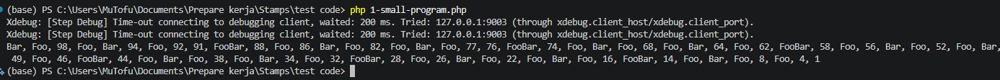
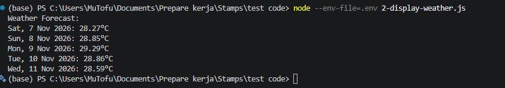

# Stamps Mini Test

## 1. Small Program (PHP)

```bash
php 1-small-program.php
```

Hasil output:



## 2. Display Weather (Javascript)

Butuh Node.js 20.6 ke atas, tidak ada dependency tambahan.

Buat file `.env` berisi API key OpenWeatherMap:

```
API_KEY=your_api_key_here
```

Lalu jalankan:

```bash
node --env-file=.env 2-display-weather.js
```

Hasil output:



### Catatan

Saya pakai endpoint `/data/2.5/forecast` (5 day / 3 hour) karena gratis. Endpoint lain yang datanya sudah per hari, seperti Daily Forecast 16 Days dan One Call 3.0, butuh akun berbayar atau harus menambahkan kartu kredit. Hasilnya selalu 5 baris karena endpoint ini hanya menyediakan data 5 hari (termasuk hari ini) ke depan dan tidak ada parameter untuk memilih per tanggal.

Data dari endpoint ini per 3 jam, jadi saya ambil setiap 8 data (8 × 3 jam = 24 jam) supaya dapat satu data per hari. Jam yang terambil mengikuti waktu program dijalankan.

Tanggal saya ambil dari `dt` (unix timestamp), bukan `dt_txt`. `dt_txt` itu waktu UTC tanpa keterangan zona, jadi kalau langsung dipakai di `new Date()` akan dibaca sebagai waktu lokal dan tanggalnya bisa geser satu hari. Dengan `dt`, tanggal selalu benar lalu ditampilkan dalam zona `Asia/Jakarta`.
